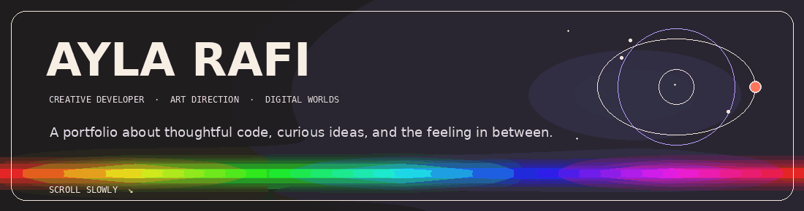
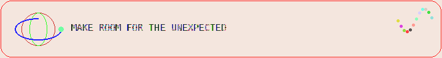
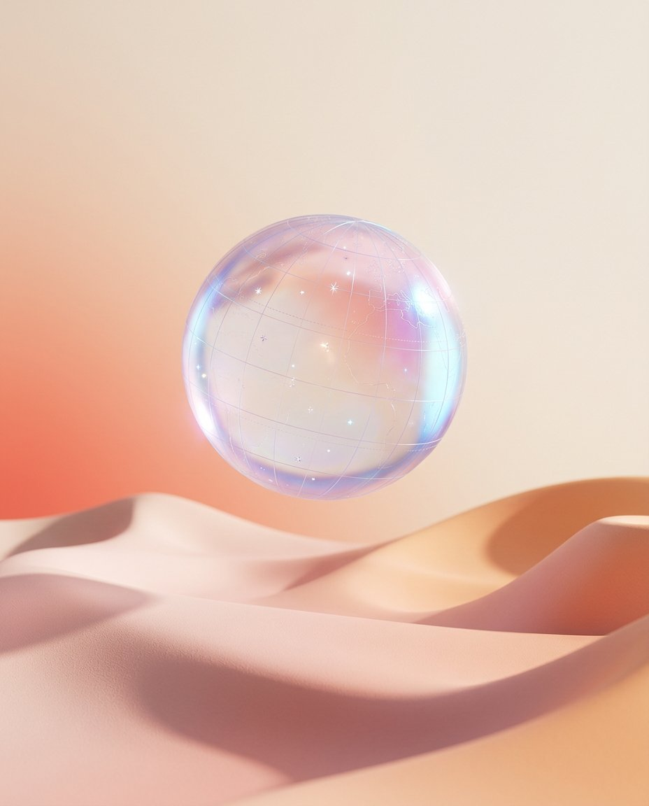
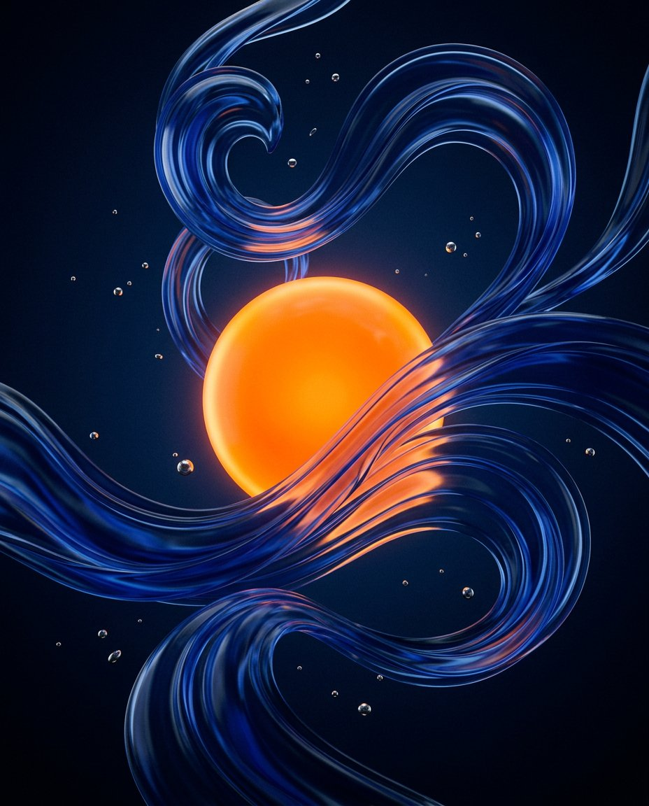
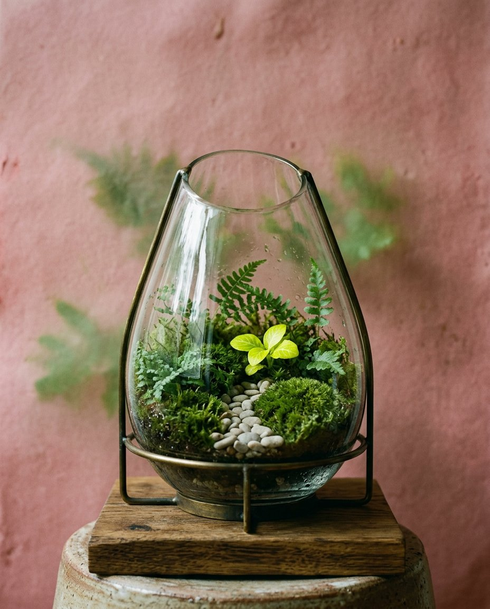
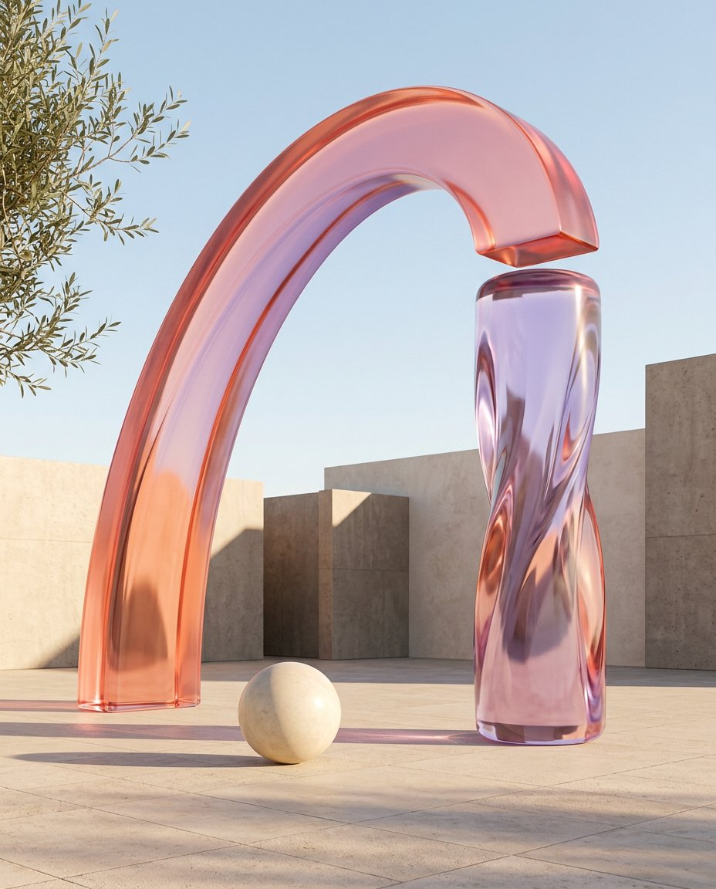
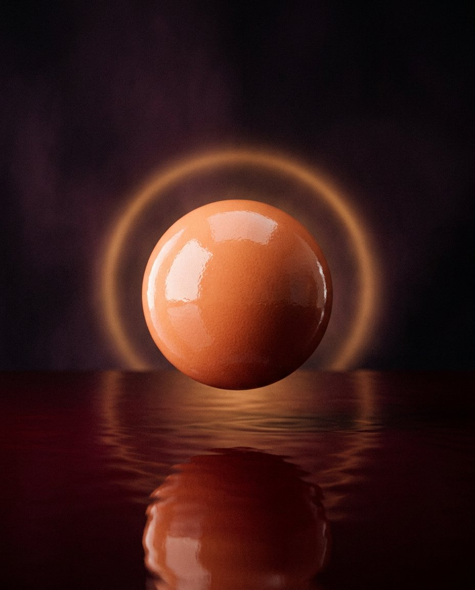

<p align="center">
  
</p>

<h1 align="center">A little world for the web.</h1>

<p align="center">
  A motion-led portfolio template for creative developers, designers and art directors.
  Built to feel considered, a little curious, and unmistakably made by a person.
</p>

<p align="center">
  <a href="#quick-start">Quick start</a> ·
  <a href="#make-it-yours">Make it yours</a> ·
  <a href="#motion-map">Motion map</a> ·
  <a href="#publish-with-github-pages">Publish</a>
</p>

<p align="center">
  
  
  
  
  
</p>

<p align="center">
  
</p>

---

## ✳ What this is

A complete, single-page portfolio inspired by expressive studio sites: a full-screen **procedural 3D Earth**, a stretched manifesto, a pinned story sequence, a rotating toolkit, five image-led project reveals, and a final wave-to-footer transition.

The page uses the same _kind_ of stack as the reference: **Vite + vanilla JavaScript + Three.js + GSAP/ScrollTrigger + Lenis**. The implementation, copy, Earth texture, mark and project artwork here are original. No runtime CDN, remote font or image dependency is required.

<p align="center">
  &nbsp;
  &nbsp;
  &nbsp;
  &nbsp;
  
</p>

<p align="center"><sub>Five original case-study images, generated for this template and stored locally in <code>public/assets/</code>.</sub></p>

---

## ◉ Quick start

**Requirements:** Node.js 20+ and npm.

```bash
git clone https://github.com/Muhammad112233-creator/Portfolio-Template-29.git
cd ayla-rafi-portfolio
npm install
npm run dev
```

Vite prints a local address—normally **http://localhost:5173**. Open it in your browser. Keep the terminal running while you preview the site.

To check the production build locally:

```bash
npm run build
npm run preview
```

The preview server normally uses **http://localhost:4173**. It serves the optimized files from `dist/`.

---

## ✿ Make it yours

| Change                                                 | Edit                                                             |
| ------------------------------------------------------ | ---------------------------------------------------------------- |
| Name, role, location, English/French copy              | `index.html` and `src/content.js`                                |
| Project titles, descriptions, years and image paths    | `src/content.js`                                                 |
| Your case-study pictures                               | Replace the five files in `public/assets/`                       |
| Contact email and social links                         | Search `index.html` for `hello@example.com`, LinkedIn and GitHub |
| Palette, typography, layout and responsive breakpoints | `src/style.css`                                                  |
| Globe, map colors, atmosphere, clouds and orbit        | `src/earth.js`                                                   |
| Page title and social-share metadata                   | The `<head>` of `index.html`                                     |
| License copyright owner                                | `LICENSE`                                                        |

The language switch in the header is functional: English and French strings live together in `src/content.js`. Keep the keys the same when changing copy so both versions continue to update.

For your own work, use **optimized portrait images** around 900 × 1100 px. Keep important content away from the edges—the image preview crops to portrait ratios on smaller screens.

<p align="center"></p>

## ✧ Motion map

The scroll is intentionally long, like a guided studio visit. The sections use sticky/pinned scenes rather than a stack of short cards.

| Section           | What happens                                                                                                             |
| ----------------- | ------------------------------------------------------------------------------------------------------------------------ |
| **Hero**          | A Three.js Earth turns with the pointer, clouds drift, a small satellite follows its orbit, and the typography eases in. |
| **Manifesto**     | A single oversized line travels horizontally through a pinned, warm-paper scene.                                         |
| **Journey**       | Four thoughts cross-fade over the long pinned sequence; two local project images and orbit lines move in and out.        |
| **Toolkit**       | Two skill decks rotate and cross-fade. Select a card to flip it and read a short note.                                   |
| **Selected work** | Five titles enter in sequence. Hover for an image; select a title for an accessible case-study dialog.                   |
| **Contact**       | A gradient sentence moves along an SVG wave, then opens onto the contact footer.                                         |

The palette, type, spacing and section navigation respond as the page moves. On small screens, the navigation becomes a working menu, the layouts reflow, the project previews become tappable dialogs, and the globe uses a lower pixel ratio. Keyboard focus styles and a reduced-motion mode are included; the Earth also has a CSS fallback if WebGL is unavailable.

---

## ◈ Project structure

```text
.
├── .github/workflows/deploy.yml   # build + publish to GitHub Pages
├── assets/                        # animated README graphics
├── public/
│   ├── assets/                    # original local project images
│   └── favicon.svg
├── src/
│   ├── content.js                 # editable copy, skills and case studies
│   ├── earth.js                   # procedural Three.js Earth
│   ├── main.js                    # Lenis, GSAP and interactions
│   └── style.css                  # responsive design system
├── .gitignore
├── LICENSE
├── README.md                      # animated project guide
├── index.html
├── package.json
├── package-lock.json
└── vite.config.js
```

`node_modules/` and `dist/` are intentionally ignored. The GitHub Pages workflow installs packages and builds `dist/` for you.

---

## ⚙️ Scripts

| Command           | Purpose                                            |
| ----------------- | -------------------------------------------------- |
| `npm run dev`     | Start the Vite development server at port 5173.    |
| `npm run build`   | Create the optimized static site in `dist/`.       |
| `npm run preview` | Preview the production build locally at port 4173. |

<p align="center"></p>

## Credits & notes

- The Earth map is drawn procedurally in `src/earth.js`; it is stylized artwork, not a navigational map.
- The case-study visuals are original generated illustrations shipped with this template.
- The bundled fonts are **DM Sans** and **Space Grotesk**, served locally through Fontsource packages.
- Built for modern browsers with WebGL support. The rest of the page remains usable without WebGL.

<p align="center"><sub>Made with care, curiosity, and a small satellite that missed its turn.</sub></p>

<div align="center">

## 🌟 Support the Project

If you find this template useful, please consider giving it a star! It helps others discover the repository and supports future development.

</div>

<p align="center"></p>
